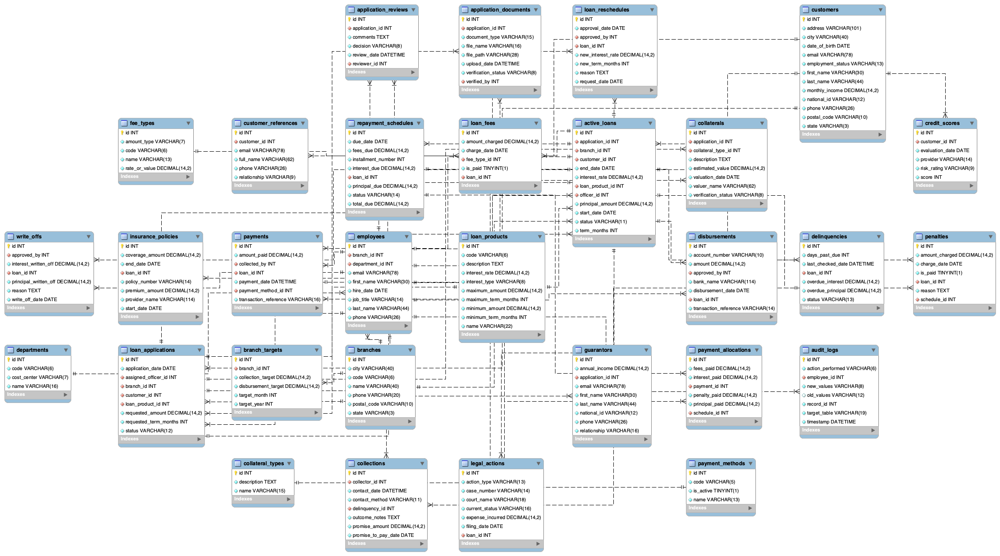

# Loan Servicing & Credit Risk Analysis | MySQL

## Project Overview

This project uses MySQL to analyze a simulated loan management database, focusing on loan portfolio analysis, payment monitoring, data quality, and credit risk.

The goal is to demonstrate how SQL can support business analysis, reporting, and decision-making in loan servicing operations.

## Tools & Technologies

- **Database:** MySQL 8.0
- **Tools:** MySQL Workbench, VS Code
- **SQL Skills:** JOIN, CTE, GROUP BY, HAVING, Aggregate Functions, Views, Date Functions, NULL Handling

## Dataset

The project uses the [Loan Management Sample Database](https://databasesample.com/datasets/loan-management-sample-database), containing 30 related tables with simulated banking and loan management data.
Of the 30 available tables, 7 relevant tables were selected based on the analytical objectives of this project
The selected tables support loan portfolio analysis, disbursement monitoring, payment analysis, and credit risk monitoring.
The analysis focuses on loan contracts, customers, disbursements, repayment schedules, payments, payment allocations, and delinquency records.

## Database Schema



## SQL Analysis

All SQL queries and reusable views are available in [scripts.sql](sql/scripts.sql), with comments in both English and German.

The analysis includes:

- Identifying active loans without recorded disbursements.
- Detecting loans with cumulative disbursements exceeding their contractual principal.
- Calculating outstanding principal for individual loans.
- Analyzing loan counts and outstanding principal by loan product and status.
- Analyzing monthly principal, interest, fee, and penalty allocations.
- Calculating unpaid installment balances.
- Identifying overdue installments with unpaid amounts.
- Identifying loans with multiple overdue installments.
- Calculating principal and interest collections for the previous calendar month.
- Monitoring unresolved delinquency records, recorded days past due (DPD), and overdue amounts.

## Key Findings

- Identified **868 loans** where cumulative recorded disbursements exceed the contractual principal amount.
- Developed two reusable SQL views to calculate outstanding principal and unpaid installment balances.
- Created SQL queries to support data quality checks, portfolio analysis, payment monitoring, and delinquency reporting.

## Limitations

The dataset contains synthetic historical data and financial inconsistencies. Calculated outstanding balances and delinquency indicators should therefore be interpreted as analytical estimates rather than verified financial figures.

Date-based queries use the current system date and may require an adjusted reference date when analyzing historical data.

## Project Structure

```text
loan_prj/
├── README.md
├── data/
├── image/
│   └── loan_erd.png
└── sql/
    └── scripts.sql
```